# Praktikum 8 — PHP dan Database MySQL

## Identitas Praktikum

| Keterangan | Informasi |
|---|---|
| Nama | Mu’ammar Kadafi |
| NIM | 312510192 |
| Program Studi / Semester | Teknik Informatika / 3 |
| Mata Kuliah | Pemrograman Web |
| Dosen Pengampu | Agung Nugroho, S.Kom., M.Kom. |
| Kelas | I253C |
| Hari / Tanggal | Sabtu, 21 November 2026 |
| Pertemuan | 10 (Online) |

## Tujuan Praktikum

1. Mahasiswa mampu memahami konsep dasar Database.
2. Mahasiswa mampu memahami konsep dasar CRUD menggunakan PHP.
3. Mahasaswa mampu membuat program CRUD sederhana menggunakan PHP.

## Langkah Praktikum

1. Mempersiapkan text editor, misalnya Visual Studio Code.
2. Instal atau siapkan XAMPP/Laragon yang menyediakan PHP dan web server Apache/Nginx.
3. Buat folder baru dengan nama `lab8_php_database` pada docroot webserver (`htdocs`).
4. Untuk memulai membuat aplikasi CRUD sederhana, yang perlu disiapkan adalah database server menggunakan MySQL. Pastikan MySQL Server sudah dapat dijalankan melalui XAMPP.
5. Menjalankan MySQL Server.

   Untuk menjalankan MySQL Server dari menu XAMPP Contol.

   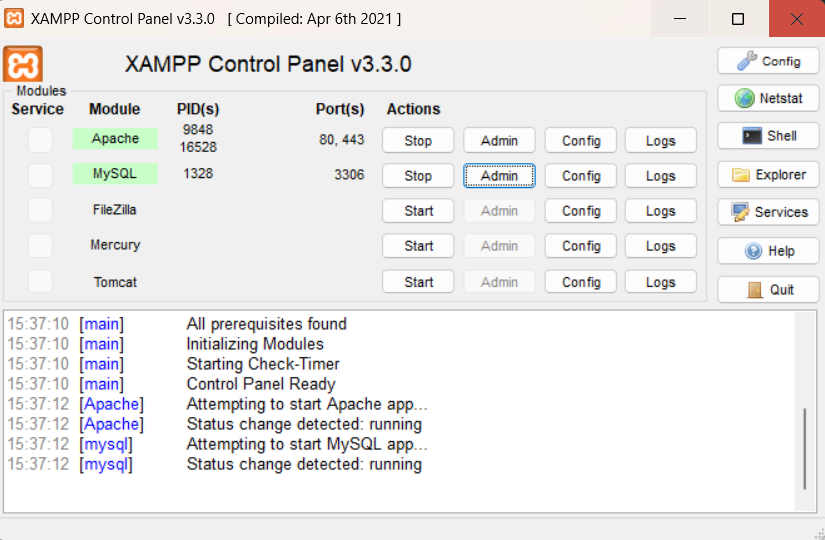

6. Mengakses MySQL Client menggunakan PHP MyAdmin.

   Pastikan webserver Apache dan MySQL server sudah dijalankan. Kemudian buka melalui browser: [http://localhost/phpmyadmin/](http://localhost/phpmyadmin/)

7. Membuat Database: Studi Kasus Data Barang.

   - **Membuat Database**

     ```sql
     CREATE DATABASE latihan1;
     ```

   - **Membuat Tabel**

     ```sql
     CREATE TABLE data_barang (
         id_barang int(10) auto_increment Primary Key,
         kategori varchar(30),
         nama varchar(30),
         gambar varchar(100),
         harga_beli decimal(10,0),
         harga_jual decimal(10,0),
         stok int(4)
     );
     ```

     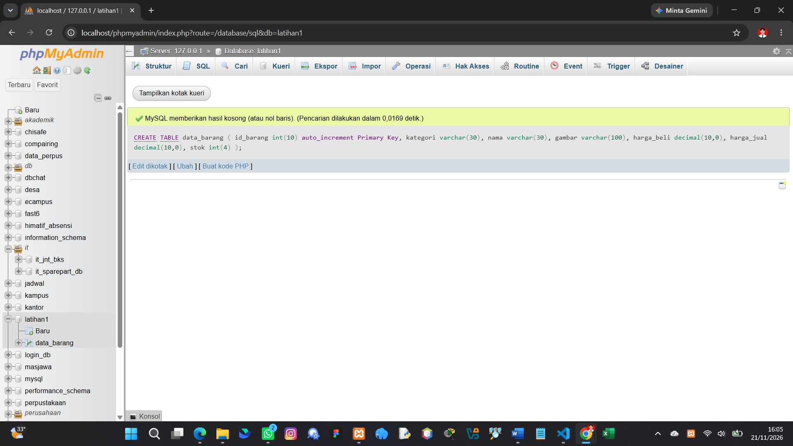

   - **Menambahkan Data**

     ```sql
     INSERT INTO data_barang (kategori, nama, gambar, harga_beli,
     harga_jual, stok)
     VALUES ('Elektronik', 'HP Samsung Android', 'hp_samsung.jpg',
     2000000, 2400000, 5),
     ('Elektronik', 'HP Xiaomi Android', 'hp_xiaomi.jpg', 1000000,
     1400000, 5),
     ('Elektronik', 'HP OPPO Android', 'hp_oppo.jpg', 1800000, 2300000,
     5);
     ```

     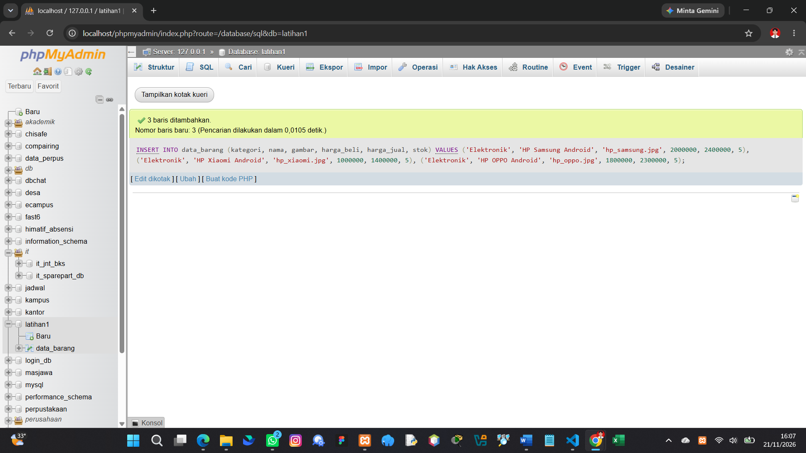

     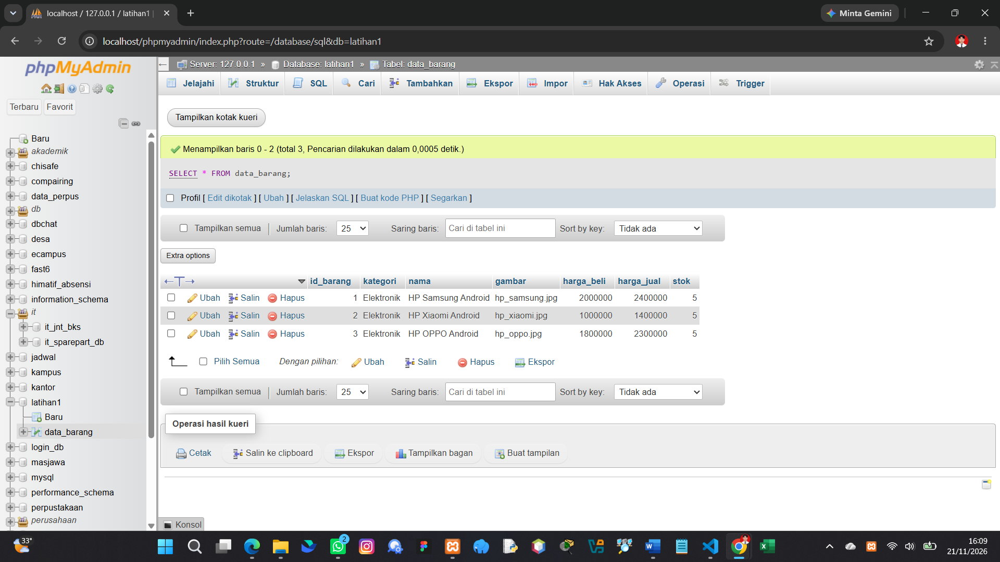

8. Membuat Program CRUD.

   Buat folder `lab8_php_database` pada root directory web server.

   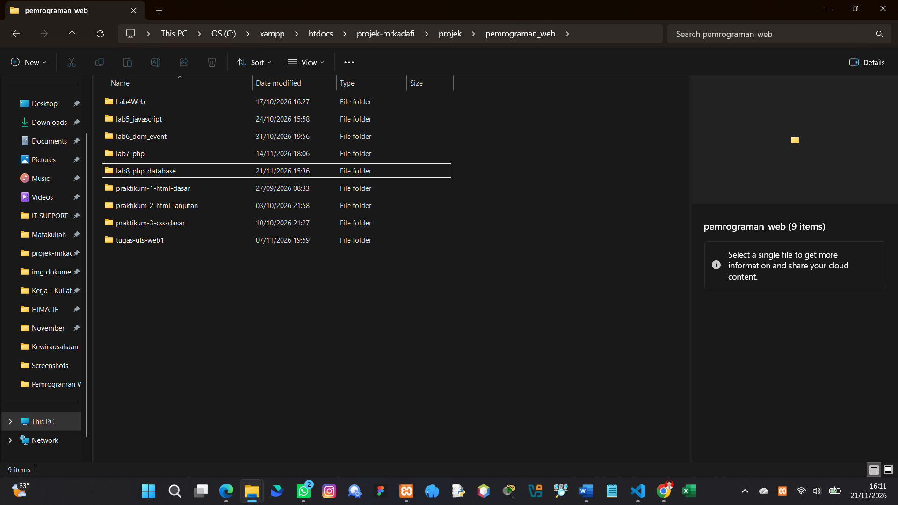

9. Kemudian untuk mengakses direktory tersebut pada web server dengan mengakses URL: [http://localhost/lab8_php_database/](http://localhost/lab8_php_database/)

   

10. Membuat file koneksi database.

    Buat file baru dengan nama `koneksi.php`.

    Pada langkah ini, dilakukan sedikit penyesuaian terhadap kode koneksi database. Pada kode awal, bagian `else` yang berisi perintah `echo "Koneksi berhasil"` masih diberi tanda komentar (`#`), sehingga pesan keberhasilan koneksi tidak ditampilkan ketika halaman dibuka melalui browser.

    Untuk mengatasinya, tanda komentar tersebut dihilangkan dan ditambahkan blok `else` agar sistem dapat menampilkan pesan "Koneksi berhasil" apabila koneksi ke database berhasil dilakukan.

    ```php
    <?php
    $host = "localhost";
    $user = "root";
    $pass = "";
    $db = "latihan1";
    $conn = mysqli_connect($host, $user, $pass, $db);

    if ($conn == false) {
        echo "Koneksi ke server gagal.";
        die();
    } else {
        echo "Koneksi berhasil";
    }
    ```

    Buka melalui browser untuk menguji koneksi database (untuk menyampilkan pesan koneksi berhasil, uncomment pada perintah echo “koneksi berhasil”;

    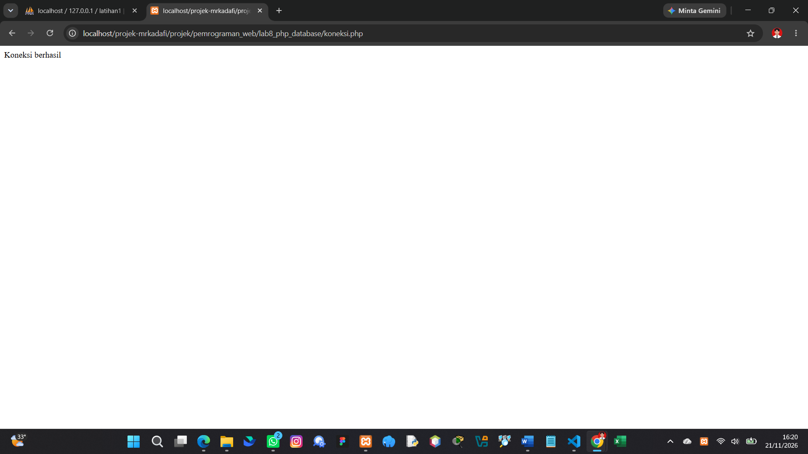

11. Membuat file index untuk menampilkan data (Read).

    Buat file baru dengan nama `index.php`.

    Pada langkah ini, dilakukan penyesuaian terhadap kode program untuk melengkapi fitur pengelolaan data barang. Kode awal belum menyediakan tombol Tambah Barang dan fitur Ubah serta Hapus pada kolom aksi. Selain itu, urutan penampilan harga jual dan harga beli belum sesuai dengan judul kolom tabel.

    Perbaikan dilakukan dengan menambahkan tombol Tambah Barang di atas tabel, menyediakan tautan Ubah dan Hapus pada setiap baris data, serta menyesuaikan urutan kolom harga jual dan harga beli. Dengan demikian, halaman Data Barang dapat menampilkan data sekaligus menyediakan akses untuk menambah, mengubah, dan menghapus data barang.

    ```php
    <?php
    include("koneksi.php");

    // Query untuk menampilkan data
    $sql = 'SELECT * FROM data_barang';
    $result = mysqli_query($conn, $sql);
    ?>

    <!DOCTYPE html>
    <html lang="id">

    <head>
        <meta charset="UTF-8">
        <link href="style.css" rel="stylesheet" type="text/css" />
        <title>Data Barang</title>
    </head>

    <body>
        <div class="container">
            <h1>Data Barang</h1>

            <div class="main">

                <!-- Tombol Tambah Barang -->
                <a href="tambah.php" class="btn btn-primary">Tambah Barang</a>

                <br><br>

                <table>
                    <tr>
                        <th>Gambar</th>
                        <th>Nama Barang</th>
                        <th>Kategori</th>
                        <th>Harga Jual</th>
                        <th>Harga Beli</th>
                        <th>Stok</th>
                        <th>Aksi</th>
                    </tr>

                    <?php if ($result && mysqli_num_rows($result) > 0): ?>

                        <?php while ($row = mysqli_fetch_array($result)): ?>
                            <tr>
                                <td>
                                    "
                                        alt="<?= htmlspecialchars($row['nama']); ?>">
                                </td>

                                <td><?= htmlspecialchars($row['nama']); ?></td>
                                <td><?= htmlspecialchars($row['kategori']); ?></td>
                                <td><?= htmlspecialchars($row['harga_jual']); ?></td>
                                <td><?= htmlspecialchars($row['harga_beli']); ?></td>
                                <td><?= htmlspecialchars($row['stok']); ?></td>

                                <td>
                                    <a href="ubah.php?id=<?= $row['id_barang']; ?>"
                                        class="btn btn-edit">Ubah</a>

                                    <a href="hapus.php?id=<?= $row['id_barang']; ?>"
                                        class="btn btn-delete"
                                        onclick="return confirm('Yakin ingin menghapus barang ini?')">
                                        Hapus
                                    </a>
                                </td>
                            </tr>
                        <?php endwhile; ?>

                    <?php else: ?>
                        <tr>
                            <td colspan="7">Belum ada data</td>
                        </tr>
                    <?php endif; ?>

                </table>
            </div>
        </div>
    </body>

    </html>
    ```

    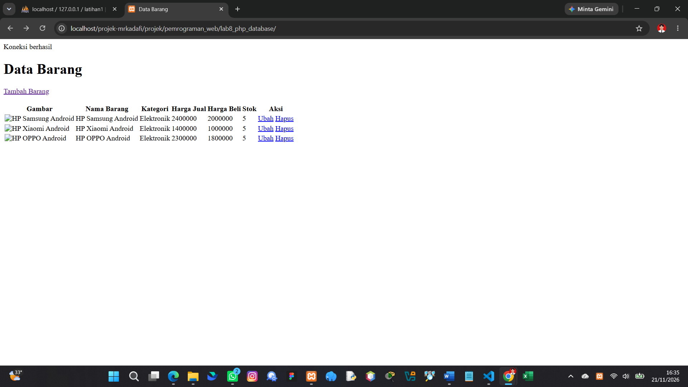

12. Menambah Data (Create).

    Buat file baru dengan nama `tambah.php`.

    ```php
    <?php
    error_reporting(E_ALL);
    include_once 'koneksi.php';

    if (isset($_POST['submit'])) {
        $nama = $_POST['nama'];
        $kategori = $_POST['kategori'];
        $harga_jual = $_POST['harga_jual'];
        $harga_beli = $_POST['harga_beli'];
        $stok = $_POST['stok'];

        $file_gambar = $_FILES['file_gambar'];
        $gambar = null;

        if ($file_gambar['error'] == 0) {
            $filename = str_replace(' ', '_', $file_gambar['name']);
            $destination = dirname(__FILE__) . '/gambar/' . $filename;

            if (move_uploaded_file($file_gambar['tmp_name'], $destination)) {
                $gambar = 'gambar/' . $filename;;
            }
        }

        $sql = 'INSERT INTO data_barang (nama, kategori,harga_jual,
                harga_beli, stok, gambar) ';
        $sql .= "VALUE ('{$nama}', '{$kategori}','{$harga_jual}',
                '{$harga_beli}', '{$stok}', '{$gambar}')";

        $result = mysqli_query($conn, $sql);
        header('location: index.php');
    }
    ?>

    <!DOCTYPE html>
    <html lang="en">

    <head>
        <meta charset="UTF-8">
        <link href="style.css" rel="stylesheet" type="text/css" />
        <title>Tambah Barang</title>
    </head>

    <body>
        <div class="container">
            <h1>Tambah Barang</h1>
            <div class="main">
                <form method="post" action="tambah.php" enctype="multipart/form-data">
                    <div class="input">
                        <label>Nama Barang</label>
                        <input type="text" name="nama" />
                    </div>

                    <div class="input">
                        <label>Kategori</label>
                        <select name="kategori">
                            <option value="Komputer">Komputer</option>
                            <option value="Elektronik">Elektronik</option>
                            <option value="Hand Phone">Hand Phone</option>
                        </select>
                    </div>

                    <div class="input">
                        <label>Harga Jual</label>
                        <input type="text" name="harga_jual" />
                    </div>

                    <div class="input">
                        <label>Harga Beli</label>
                        <input type="text" name="harga_beli" />
                    </div>

                    <div class="input">
                        <label>Stok</label>
                        <input type="text" name="stok" />
                    </div>

                    <div class="input">
                        <label>File Gambar</label>
                        <input type="file" name="file_gambar" />
                    </div>

                    <div class="submit">
                        <input type="submit" name="submit" value="Simpan" />
                    </div>
                </form>
            </div>
        </div>
    </body>

    </html>
    ```

    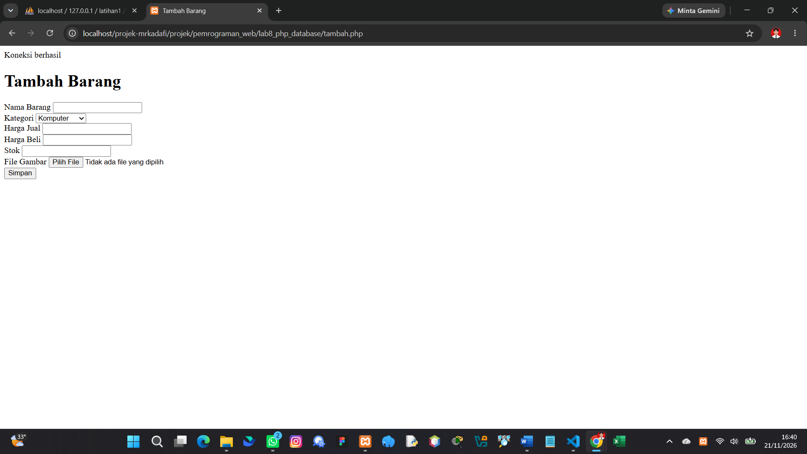

    Kemudian lakukan penambahan barang seperti berikut.

    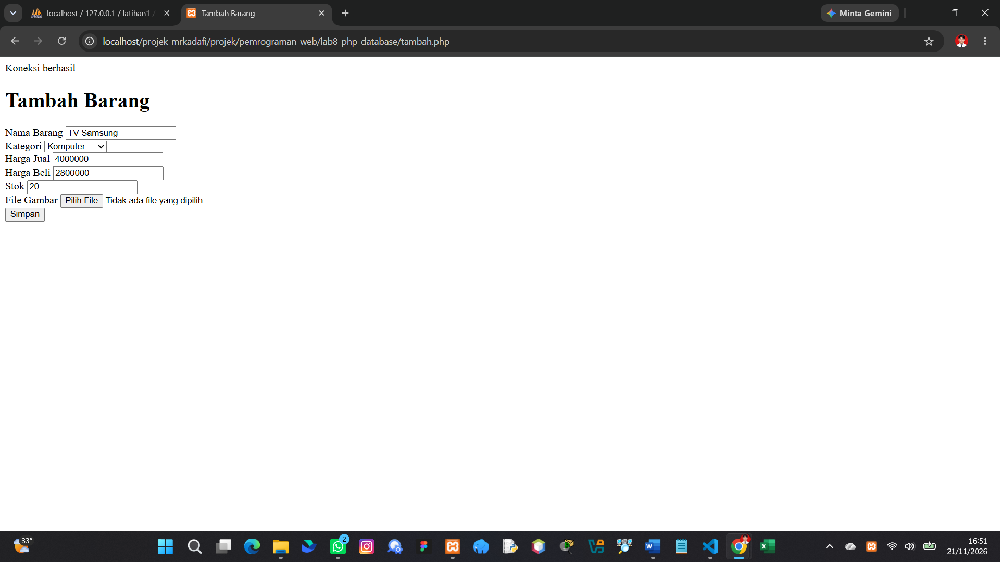

    

13. Mengubah Data (Update).

    Buat file baru dengan nama `ubah.php`.

    Pada langkah ini, dilakukan perbaikan terhadap kode program ubah.php, khususnya pada bagian pemilihan kategori barang. Pada kode awal, kondisi fungsi `is_select()` menggunakan nilai kategori "Komputer" untuk seluruh pilihan kategori. Hal tersebut menyebabkan kategori yang ditampilkan tidak sesuai dengan data yang tersimpan di database.

    Perbaikan dilakukan dengan menyesuaikan nilai pada setiap pilihan kategori, yaitu "Komputer", "Elektronik", dan "Hand Phone". Selain itu, atribut `enctype="multipart/form-data"` diperbaiki agar proses unggah gambar dapat berjalan dengan baik. Dengan perbaikan tersebut, kategori barang yang sebelumnya tersimpan di database akan otomatis terpilih ketika halaman Ubah Barang dibuka.

    ```php
    <?php
    error_reporting(E_ALL);
    include_once 'koneksi.php';

    if (isset($_POST['submit'])) {
        $id = $_POST['id'];
        $nama = $_POST['nama'];
        $kategori = $_POST['kategori'];
        $harga_jual = $_POST['harga_jual'];
        $harga_beli = $_POST['harga_beli'];
        $stok = $_POST['stok'];

        $file_gambar = $_FILES['file_gambar'];
        $gambar = null;

        if ($file_gambar['error'] == 0) {
            $filename = str_replace(' ', '_', $file_gambar['name']);
            $destination = dirname(__FILE__) . '/gambar/' . $filename;

            if (move_uploaded_file($file_gambar['tmp_name'], $destination)) {
                $gambar = 'gambar/' . $filename;
            }
        }

        $sql = 'UPDATE data_barang SET ';
        $sql .= "nama = '{$nama}', kategori = '{$kategori}', ";
        $sql .= "harga_jual = '{$harga_jual}', harga_beli = '{$harga_beli}', ";
        $sql .= "stok = '{$stok}' ";

        if (!empty($gambar)) {
            $sql .= ", gambar = '{$gambar}' ";
        }

        $sql .= "WHERE id_barang = '{$id}'";

        $result = mysqli_query($conn, $sql);

        header('location: index.php');
        exit;
    }

    $id = $_GET['id'];

    $sql = "SELECT * FROM data_barang WHERE id_barang = '{$id}'";
    $result = mysqli_query($conn, $sql);

    if (!$result) {
        die('Error: Data tidak tersedia');
    }

    $data = mysqli_fetch_array($result);

    if (!$data) {
        die('Error: Data tidak ditemukan');
    }

    function is_select($var, $val)
    {
        if ($var == $val) {
            return 'selected="selected"';
        }

        return false;
    }
    ?>

    <!DOCTYPE html>
    <html lang="id">

    <head>
        <meta charset="UTF-8">
        <link href="style.css" rel="stylesheet" type="text/css" />
        <title>Ubah Barang</title>
    </head>

    <body>
        <div class="container">
            <h1>Ubah Barang</h1>

            <div class="main">

                <form method="post" action="ubah.php" enctype="multipart/form-data">

                    <div class="input">
                        <label>Nama Barang</label>
                        <input type="text" name="nama" value="<?php echo $data['nama']; ?>" />
                    </div>

                    <div class="input">
                        <label>Kategori</label>

                        <select name="kategori">
                            <option <?php echo is_select('Komputer', $data['kategori']); ?> value="Komputer">
                                Komputer
                            </option>

                            <option <?php echo is_select('Elektronik', $data['kategori']); ?> value="Elektronik">
                                Elektronik
                            </option>

                            <option <?php echo is_select('Hand Phone', $data['kategori']); ?> value="Hand Phone">
                                Hand Phone
                            </option>
                        </select>
                    </div>

                    <div class="input">
                        <label>Harga Jual</label>
                        <input type="text" name="harga_jual" value="<?php echo $data['harga_jual']; ?>" />
                    </div>

                    <div class="input">
                        <label>Harga Beli</label>
                        <input type="text" name="harga_beli" value="<?php echo $data['harga_beli']; ?>" />
                    </div>

                    <div class="input">
                        <label>Stok</label>
                        <input type="text" name="stok" value="<?php echo $data['stok']; ?>" />
                    </div>

                    <div class="input">
                        <label>File Gambar</label>
                        <input type="file" name="file_gambar" />
                    </div>

                    <div class="submit">
                        <input type="hidden" name="id" value="<?php echo $data['id_barang']; ?>" />
                        <input type="submit" name="submit" value="Simpan" />
                    </div>

                </form>
            </div>
        </div>
    </body>

    </html>
    ```

    Kemudian ubah data TV Samsung seperti berikut.

    

    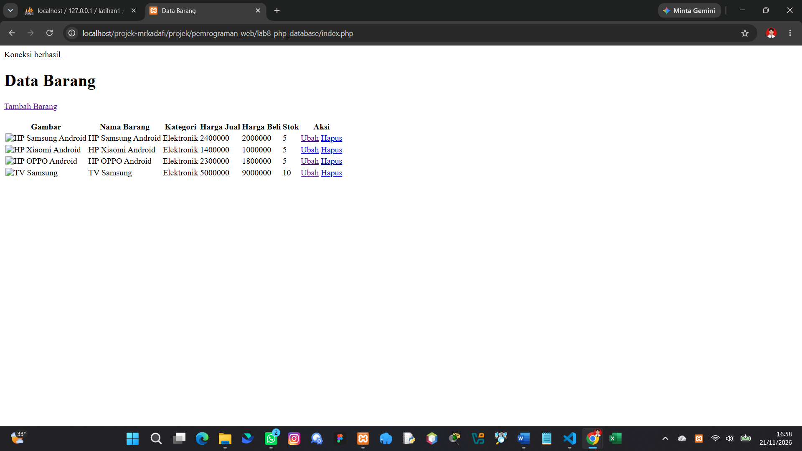

14. Menghapus Data (Delete).

    Buat file baru dengan nama `hapus.php`.

    ```php
    <?php
    include_once 'koneksi.php';
    $id = $_GET['id'];
    $sql = "DELETE FROM data_barang WHERE id_barang = '{$id}'";
    $result = mysqli_query($conn, $sql);
    header('location: index.php');
    ?>
    ```

    Kemudian tekan tombol hapus pada data TV Samsung.

    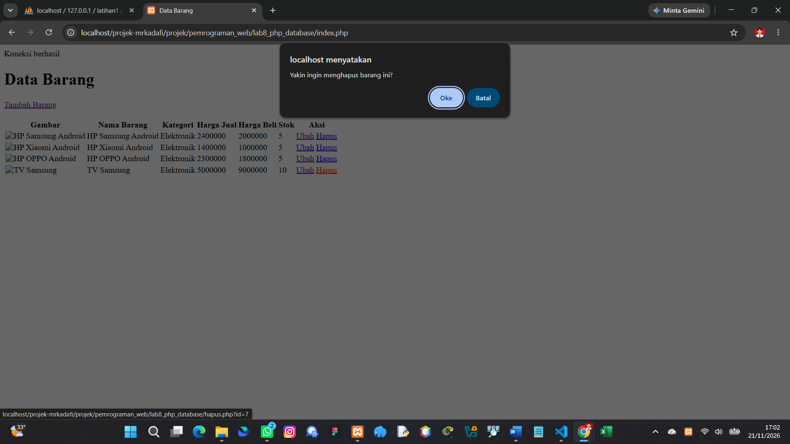

    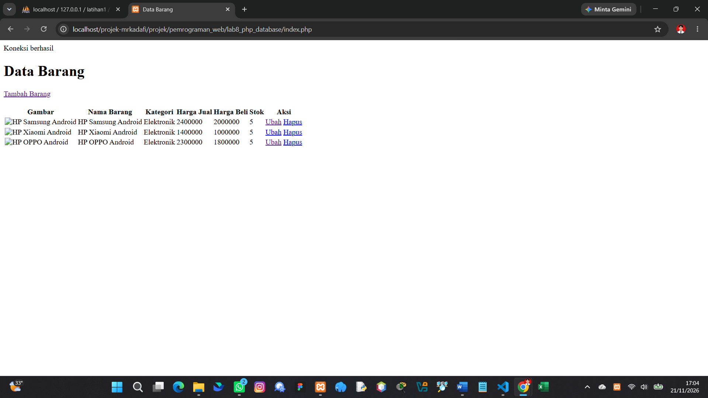
